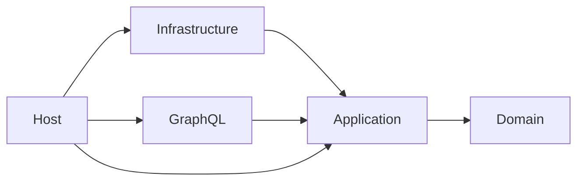

# Bookshop clean architecture example

A runnable GraphQL bookshop demonstrating domain-driven design and clean architecture with
HotChocolate, GreenDonut DataLoaders, Mocha.Mediator, EF Core, and PostgreSQL.

## Projects

```text
Bookshop.Domain          Aggregates, domain services, events, exceptions, repository contracts
Bookshop.Application     Commands, queries, authorization policies, and read models
Bookshop.Infrastructure  EF Core, repositories, DataLoaders, transactions, and event dispatch
Bookshop.GraphQL         HotChocolate query, mutation, and object type extensions
Bookshop.Host            Composition root, health checks, migrations, and development seed data
```

Dependencies point inward:



The Domain project groups each feature into `Models`, `Repositories`, `Services`, `Events`, and
`Exceptions`. Every public domain type has its own file. Identifiers and scalar business data use
plain `Guid`, `string`, and `decimal` values; aggregate methods still enforce domain invariants.

## Notable patterns

- Commands and queries live in the Application layer under feature-specific `Commands` and
  `Queries` folders.
- Authorization is enforced in command/query handlers, so it applies independently of transport.
  The Host registers an allow-all implementation solely to keep the standalone example runnable.
- Root collection queries use Application handlers backed by source-generated DataLoaders.
- GraphQL by-id and relationship fields use DataLoaders and projection-aware `QueryContext<T>`.
- Command middleware opens an EF transaction. `UnitOfWork` saves changes and dispatches collected
  domain events.
- Domain-event diagnostics use `ActivitySource` and structured `ILogger` messages.
- Expected add-book failures are domain exceptions and flow directly through the GraphQL resolver.
- Read-model properties are all `required`.

## Run

Start PostgreSQL:

```bash
docker compose up -d
```

Run the API in Development so it uses the compose port and inserts sample data:

```bash
ASPNETCORE_ENVIRONMENT=Development dotnet run --project src/Bookshop.Host
```

The GraphQL endpoint is `/graphql`. Health endpoints are `/_health/live` and
`/_health/ready`. The host applies pending migrations automatically.

Stop PostgreSQL and remove its volume with:

```bash
docker compose down -v
```

## Verify

```bash
dotnet build Bookshop.slnx
dotnet test Bookshop.slnx --no-build
dotnet ef migrations has-pending-model-changes \
  --project src/Bookshop.Infrastructure \
  --startup-project src/Bookshop.Infrastructure
dotnet run --project src/Bookshop.Host -- schema export --output schema.graphql
```

## Example query

```graphql
query Books {
  books(first: 10) {
    nodes {
      id
      title
      isbn
      price
      currency
      stockQuantity
    }
  }
}
```

## Example mutation

```graphql
mutation AddBook($authorId: ID!) {
  addBook(
    input: {
      title: "Domain-Driven Design"
      isbn: "9780306406157"
      price: 39.99
      currency: "USD"
      authorId: $authorId
      initialStock: 5
    }
  ) {
    book {
      id
      title
      stockQuantity
    }
  }
}
```

This example deliberately lets add-book domain exceptions propagate as ordinary GraphQL execution
errors. A production API should translate expected exceptions into a stable public error contract.
